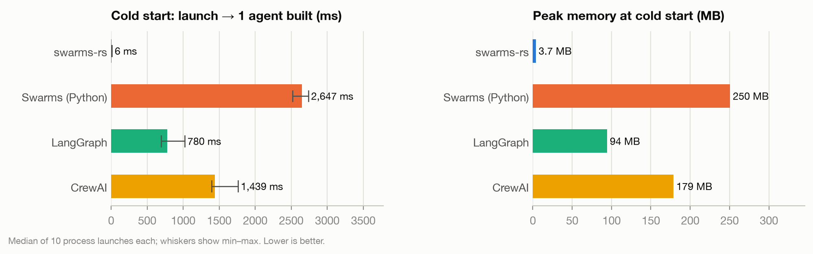
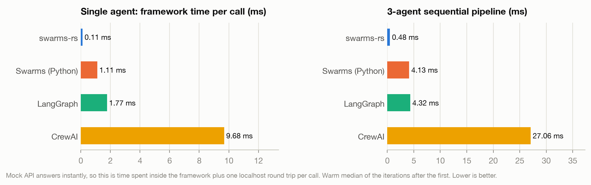
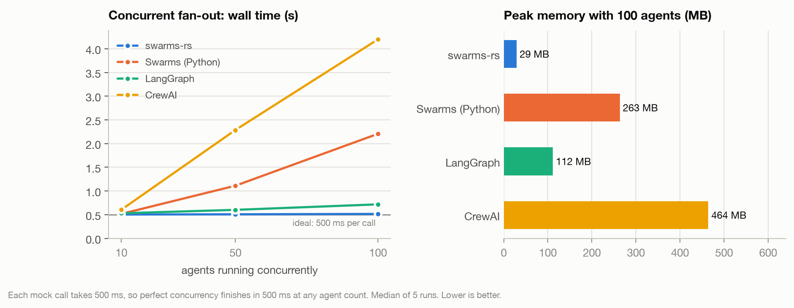
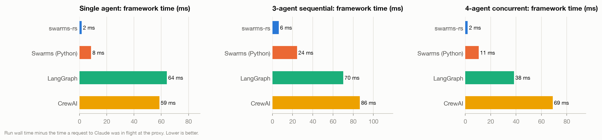

# swarms-rust-benchmark

An open, reproducible benchmark of four multi-agent frameworks running the same agents on the same model:

- **[swarms-rs](https://github.com/The-Swarm-Corporation/swarms-rs)** 0.3.0 (Rust)
- **[Swarms](https://github.com/kyegomez/swarms)** 15.0.3 (Python)
- **[LangGraph](https://github.com/langchain-ai/langgraph)** 1.2.12, with langchain-anthropic 1.7.5
- **[CrewAI](https://github.com/crewAIInc/crewAI)** 1.15.23

Every framework drives **Claude Sonnet 5.5** (`claude-sonnet-5-5`). The repo contains the benchmark code and the published report with its charts, in [`comparisons/`](comparisons/). Raw results and logs aren't committed: run the suites to generate your own.

## Results at a glance

Run on 2026-09-30 on an Apple M3 Pro (12 cores, 18 GB), macOS 15 (Darwin 24.6), Python 3.12.3, rustc 1.98.1.

### Framework overhead (mock API)

Measured against a mock API, so there is no model or network variance:

| | swarms-rs | Swarms (Python) | LangGraph | CrewAI |
|---|---:|---:|---:|---:|
| Cold start (launch to agent ready) | **6 ms** | 2,647 ms | 780 ms | 1,439 ms |
| Memory at cold start | **3.7 MB** | 250 MB | 94 MB | 179 MB |
| Framework time per LLM call (warm) | **0.11 ms** | 1.11 ms | 1.77 ms | 9.68 ms |
| 3-agent sequential pipeline (warm) | **0.48 ms** | 4.13 ms | 4.32 ms | 27.06 ms |
| 100 concurrent agents, 500 ms calls: wall time | **0.52 s** | 2.21 s | 0.72 s | 4.20 s |
| 100 concurrent agents: parallel efficiency | **97%** | 23% | 70% | 12% |
| 100 concurrent agents: peak requests in flight | **100** | 32 | 100 | 16 |
| 100 concurrent agents: peak memory | **29 MB** | 263 MB | 112 MB | 464 MB |







### Live runs on `claude-sonnet-5-5`

104 API calls, 44 workflow runs, 0 errors:

| | swarms-rs | Swarms (Python) | LangGraph | CrewAI |
|---|---:|---:|---:|---:|
| Single agent: latency (median) | 3.85 s | 4.56 s | 5.52 s | 3.81 s |
| Single agent: framework time | **2 ms** | 8 ms | 64 ms | 59 ms |
| Single agent: prompt tokens | 88 | **69** | **69** | 181 |
| 3-agent sequential: latency | 12.34 s | 11.95 s | 12.97 s | 12.00 s |
| 3-agent sequential: framework time | **6 ms** | 24 ms | 70 ms | 86 ms |
| 3-agent sequential: prompt tokens | 1,869 | 1,661 | **1,189** | 1,919 |
| 4-agent concurrent: latency | 6.81 s | 6.47 s | 5.74 s | 6.33 s |
| 4-agent concurrent: framework time | **2 ms** | 11 ms | 38 ms | 69 ms |
| 4-agent concurrent: prompt tokens | 441 | **365** | **365** | 817 |
| Peak memory (any live scenario) | **4 to 5 MB** | 244 to 252 MB | 98 to 99 MB | 179 to 185 MB |



Every table, including per-scenario breakdowns, is in [`comparisons/SUMMARY.md`](comparisons/SUMMARY.md).

## Findings

1. **Model time dominates end-to-end latency on real calls.**
   - Every framework's latency falls within the API's own run-to-run spread: 3.6 to 8.6 s for a single agent, 11.1 to 13.9 s for the pipeline.
   - With 3 to 5 runs per cell, the live latency ranking is noise.
   - What frameworks actually control is framework time, prompt tokens and memory.
2. **swarms-rs has the lowest overhead on every framework-controlled metric.**
   - Against the Python frameworks: startup is 130x to 440x faster, idle memory 25x to 68x smaller, and per-call orchestration 10x to 88x cheaper.
   - On live calls, swarms-rs spends 2 to 6 ms of its own time per run, versus 8 to 86 ms for the others.
3. **Concurrency caps separate the frameworks at scale.** Measured at the proxy:
   - **CrewAI:** `akickoff` never has more than 16 requests in flight, matching Python's default thread pool size on this machine.
   - **Swarms (Python):** `ConcurrentWorkflow` caps at 32 (`MAX_CONCURRENT_AGENTS`; raise it with `max_workers`).
   - **LangGraph:** runs all 100 at once, but loses about 30% efficiency to per-call CPU cost on its single event loop.
   - **swarms-rs:** runs all 100 at once and stays at 97% efficiency in 29 MB.
4. **Prompt scaffolding differs by up to 2.6x for the same task.**
   - **CrewAI** wraps each task in its ReAct template and sends `stop_sequences: ["\nObservation:"]`: 181 prompt tokens vs 69 for a single agent. It also turns on Anthropic prompt caching when handing off between agents, so 1,723 of its 1,919 sequential prompt tokens are cache writes.
   - **LangGraph** is lowest on the sequential pipeline because this benchmark's graph hands each agent only the task plus the previous agent's output. Swarms and CrewAI pass accumulated context by design.
5. **swarms-rs sends 12% to 28% more prompt tokens than Swarms (Python).** Compare the requests side by side in [`prompts.md`](comparisons/prompts.md).
   - **Timestamp prefix:** every user turn is wrapped as `User: Timestamp(millis): …` ([swarms-rs#106](https://github.com/The-Swarm-Corporation/swarms-rs/issues/106)).
   - **Transcript forwarding:** `Agent::run` returns the timestamped transcript rather than just the reply, and `SequentialWorkflow` forwards it to the next agent ([swarms-rs#105](https://github.com/The-Swarm-Corporation/swarms-rs/issues/105)).
6. **Every framework honoured the settings.**
   - No `temperature` or `top_p` was sent (Sonnet 5.5 rejects `temperature`).
   - `max_tokens=4096` everywhere.
   - Exactly one HTTP call per agent run, no retries.

### Caveats

- **Live framework time includes one-time client setup.** Each live run is a fresh process, so the figure is a cold first call. The mock suite's warm numbers show the steady state.
- **Thinking tokens are the model's choice.** Sonnet 5.5 used them once (271 tokens on one swarms-rs concurrent call); no framework requested them.
- **Frameworks run on their defaults**, apart from the fairness controls below. Tuning changes the concurrency results, e.g. Swarms (Python) `max_workers` or a larger thread pool for CrewAI.
- **One machine, one date.** Rerun the suites to reproduce on other hardware.

## What is measured

Each framework runs the same three workflows with identical agent names, system prompts and tasks, all defined in [`tasks.json`](tasks.json):

| Scenario | Shape | swarms-rs | Swarms (Python) | LangGraph | CrewAI |
|---|---|---|---|---|---|
| `single` | 1 agent, 1 task | `SwarmsAgent` | `Agent` | 1-node `StateGraph` | 1-agent `Crew` |
| `sequential` | Researcher, then Analyst, then Writer | `SequentialWorkflow` | `SequentialWorkflow` | 3-node chain | `Process.sequential` |
| `concurrent` | N agents on one task in parallel | `ConcurrentWorkflow` | `ConcurrentWorkflow` | fan-out from `START` | one `Crew.akickoff()` per agent |

There are two suites:

1. **`mock`: framework overhead.** A local mock of the Anthropic Messages API answers instantly, or after a fixed 500 ms in the concurrency test. With no model or network variance, what's left is the framework's own cost:
   - cold start and memory (10 process launches per framework)
   - per-call orchestration time (30 iterations)
   - the 3-agent pipeline (10 iterations)
   - concurrency at 10, 50 and 100 agents (5 runs each)

   It costs nothing to run.
2. **`live`: real Claude calls.** A pass-through proxy forwards every request to `api.anthropic.com` and records its usage. Runs: 5 single-agent, 3 sequential, and 3 four-agent concurrent. The framework-specific signals are time spent outside the API, prompt tokens and HTTP calls.

### Fairness controls

- **Same model settings everywhere:**
  - `claude-sonnet-5-5` with `max_tokens=4096`
  - no `temperature` or `top_p`
  - no tools
  - one loop per agent
- **One measurement path.** Every framework points its base URL at [`harness/proxy.py`](harness/proxy.py), so HTTP calls, tokens and request bytes are counted the same way for all four.
- **Isolated installs:**
  - Each Python framework has its own virtualenv, so import time and memory aren't inflated by the others' dependencies.
  - swarms-rs is built with `--release`.
- **Fresh objects per iteration.** Agents and workflows are rebuilt each time, so conversation memory never carries over between runs.
- **Telemetry off for all:**
  - `SWARMS_TELEMETRY_ON=false`
  - `CREWAI_DISABLE_TELEMETRY=true`
  - `CREWAI_TRACING_ENABLED=false`
  - `OTEL_SDK_DISABLED=true`
  - LangSmith tracing off
- **Warm caches.** One discarded launch per framework runs before timing starts, so Python bytecode caches already exist.
- **Interleaving.** Launch order rotates each repetition, spreading API latency drift evenly across frameworks.
- **Peak memory** comes from `/usr/bin/time -l` wrapped around every process.
- **swarms-rs task evaluator disabled.** swarms-rs runs with `disable_task_complete_tool()`; otherwise it attaches its task-evaluator tool to every request while the others send none ([swarms-rs#108](https://github.com/The-Swarm-Corporation/swarms-rs/issues/108)).

## Reproduce

### Requirements

- **macOS.** Peak memory is parsed from the output of `/usr/bin/time -l`.
- **Rust 1.88 or newer.**
- **Python 3.12 and [uv](https://github.com/astral-sh/uv).**
- **An Anthropic API key**, for the live suite only.

### Setup

```bash
git clone https://github.com/The-Swarm-Corporation/swarms-rust-benchmark
cd swarms-rust-benchmark

# One virtualenv per framework, pinned to the exact versions benchmarked
for env in swarms langgraph crewai harness; do
  uv venv -q --python 3.12 .venvs/$env
  VIRTUAL_ENV=.venvs/$env uv pip install -r requirements/$env.txt
done

cp .env.example .env   # then add your ANTHROPIC_API_KEY (live suite only)
```

The swarms-rs benchmark is built automatically by `harness/run.py`.

### Run

```bash
.venvs/harness/bin/python harness/run.py --suite mock   # about 3 minutes, no API cost
.venvs/harness/bin/python harness/run.py --suite live   # about 6 minutes, 104 Claude calls
.venvs/harness/bin/python harness/compare.py            # rebuilds comparisons/ from results/
```

- **Output.** `run.py` writes raw results and logs to `results/<suite>/`, replacing that suite's previous run. `results/` is gitignored, so these are yours alone.
- **Rebuilding the report.** `compare.py` regenerates `comparisons/` from your local results. Run both suites first to rebuild the full report; with no results it exits without touching the published one.
- **Options:**
  - `--frameworks swarms-rs langgraph` runs a subset.
  - `--model` changes the model.
  - `--max-tokens` changes the token limit.
- **API key.** The live suite reads `ANTHROPIC_API_KEY` from the environment, or from `.env`.

### Testing other versions

- **Newer Python framework releases:** install `swarms`, `langgraph langchain-anthropic` or `'crewai[anthropic]'` without the requirements file.
- **A local swarms-rs checkout:** point the dependency in [`rust/Cargo.toml`](rust/Cargo.toml) at it:

  ```toml
  swarms-rs = { path = "/path/to/swarms-rs/swarms-rs" }
  ```

  The version recorded in the results is read from `Cargo.lock`, so it follows whichever source you use.

## Layout

```
.
├── tasks.json              shared agents, system prompts and tasks
├── rust/                   swarms-rs benchmark (cargo crate)
├── python/
│   ├── common.py           shared CLI and timing/recording (no framework imports)
│   ├── bench_swarms.py
│   ├── bench_langgraph.py
│   └── bench_crewai.py
├── harness/
│   ├── proxy.py            mock and recording proxy for the Anthropic Messages API
│   ├── run.py              runs a suite and writes results/<suite>/
│   └── compare.py          builds comparisons/ from results/
├── requirements/           exact package versions for each virtualenv
├── results/<suite>/        generated by run.py, not committed
│   ├── manifest.json       machine, versions, model and run plan
│   ├── runs/*.json         one file per framework process: timings, peak memory, every HTTP call
│   ├── runs.csv            flattened, one row per iteration
│   ├── requests/*.json     the first request bodies each framework sent
│   └── logs/               stdout/stderr of every process
└── comparisons/            the published report (committed)
    ├── SUMMARY.md          every table and chart
    ├── *.csv               aggregated metrics per framework
    ├── charts/*.png
    └── prompts.md          what each framework sends to Claude, side by side
```

## Adding a framework

Each benchmark program takes the same arguments and writes the same JSON, so a new framework only needs one program and one entry in `FRAMEWORKS` in [`harness/run.py`](harness/run.py).

The program must:

- **Accept** `--scenario {coldstart,single,sequential,concurrent} --iterations N --n-agents N --out FILE`.
- **Read** `BENCH_BASE_URL`, `BENCH_MODEL` and `BENCH_MAX_TOKENS` from the environment, and send every model call to `BENCH_BASE_URL`.
- **Build** a fresh agent or workflow for each iteration, timing construction (`build_s`) and execution (`run_s`) separately.
- **Write** `{framework, version, scenario, n_agents, model, max_tokens, import_s, runs: [{build_s, run_s, ok, error, output_chars, output_preview}]}` to `--out`.

[`python/common.py`](python/common.py) implements all of this for Python frameworks.

## License

[Apache 2.0](LICENSE)
