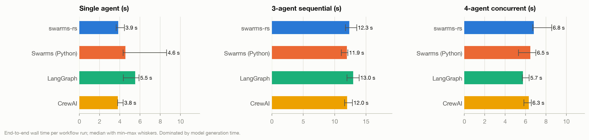
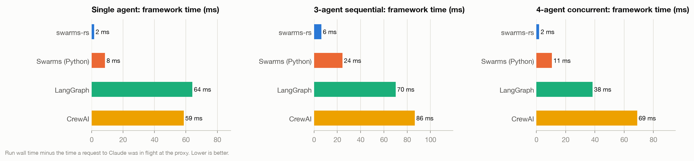
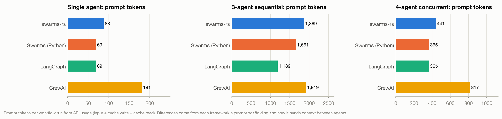
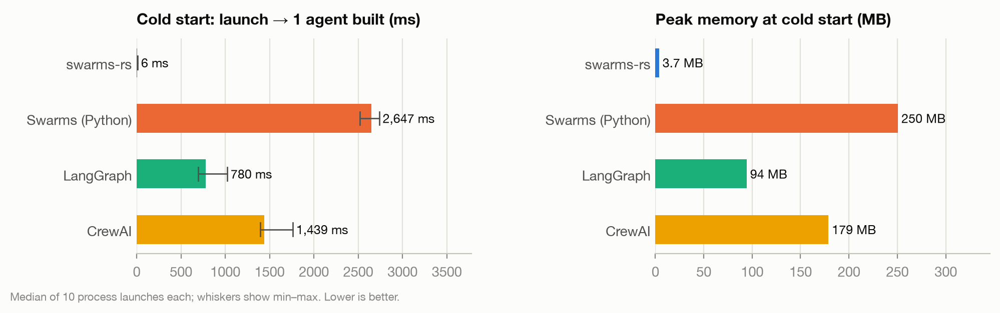
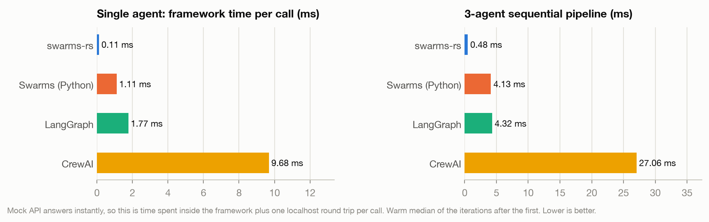
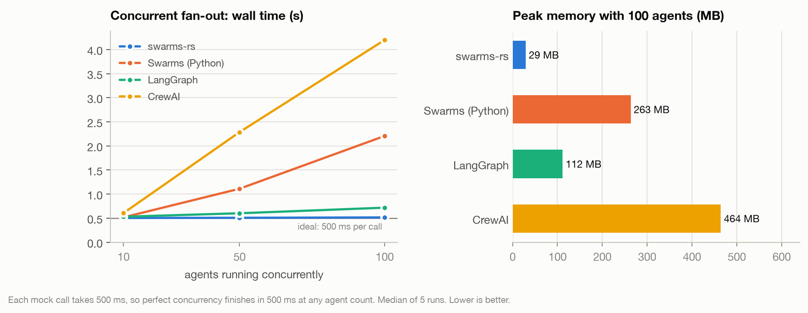

# Benchmark comparison

Generated by `harness/compare.py` from `results/`. Frameworks: swarms-rs, Swarms (Python), LangGraph, CrewAI.

- **mock**: 2026-09-30T16:12:32+00:00, Apple M3 Pro (12 cores, 18.0 GB), Darwin 24.6.0, Python 3.12.3, rustc 1.98.1 (48a229cea 2026-09-01); model `claude-sonnet-5-5`, max_tokens 4096
- **live**: 2026-09-30T16:15:37+00:00, Apple M3 Pro (12 cores, 18.0 GB), Darwin 24.6.0, Python 3.12.3, rustc 1.98.1 (48a229cea 2026-09-01); model `claude-sonnet-5-5`, max_tokens 4096

## Live runs on `claude-sonnet-5-5`

Real Anthropic API calls through a recording pass-through proxy. Latency here is dominated by the model, so the useful comparisons are framework time outside the API, tokens sent, and HTTP calls. Framework processes were interleaved round-robin to spread API latency drift evenly.

| Scenario | Framework | Latency median (min–max) | Framework time | HTTP calls | Prompt tok | of which cache write | Output tok | Thinking tok | Peak RSS | OK |
|---|---:|---:|---:|---:|---:|---:|---:|---:|---:|---:|
| single | swarms-rs | 3.85 s (3.6–4.4) | 2 ms | 1.0 | 88 | 0 | 386 | 0 | 4 MB | 5/5 |
| single | swarms-python | 4.56 s (4.3–8.6) | 8 ms | 1.0 | 69 | 0 | 390 | 0 | 247 MB | 5/5 |
| single | langgraph | 5.52 s (4.3–5.9) | 64 ms | 1.0 | 69 | 0 | 395 | 0 | 99 MB | 5/5 |
| single | crewai | 3.81 s (3.8–4.3) | 59 ms | 1.0 | 181 | 0 | 387 | 0 | 179 MB | 5/5 |
| sequential | swarms-rs | 12.34 s (11.7–13.5) | 6 ms | 3.0 | 1869 | 0 | 1284 | 0 | 4 MB | 3/3 |
| sequential | swarms-python | 11.95 s (11.1–12.1) | 24 ms | 3.0 | 1661 | 0 | 1263 | 0 | 252 MB | 3/3 |
| sequential | langgraph | 12.97 s (12.0–13.9) | 70 ms | 3.0 | 1189 | 0 | 1315 | 0 | 98 MB | 3/3 |
| sequential | crewai | 12.00 s (11.6–12.8) | 86 ms | 3.0 | 1919 | 1723 | 1239 | 0 | 182 MB | 3/3 |
| concurrent | swarms-rs | 6.81 s (6.7–8.6) | 2 ms | 4.0 | 441 | 0 | 2207 | 271 | 5 MB | 3/3 |
| concurrent | swarms-python | 6.47 s (5.3–7.0) | 11 ms | 4.0 | 365 | 0 | 1819 | 0 | 244 MB | 3/3 |
| concurrent | langgraph | 5.74 s (5.7–6.3) | 38 ms | 4.0 | 365 | 0 | 1832 | 0 | 99 MB | 3/3 |
| concurrent | crewai | 6.33 s (5.8–6.5) | 69 ms | 4.0 | 817 | 0 | 1867 | 0 | 185 MB | 3/3 |

## Framework overhead (mock Anthropic API)

Every framework talks to a local mock of the Messages API that answers instantly (or after a fixed 500 ms for the concurrency test), so these numbers are the frameworks' own cost: startup, memory, per-call orchestration and concurrency. No model or network variance.

### Cold start and memory

| Framework | Version | Process start → agent ready | Framework import | Agent construction | Peak RSS |
|---|---:|---:|---:|---:|---:|
| swarms-rs | 0.3.0 | 6 ms | 0 ms | 0.01 ms | 3.7 MB |
| swarms-python | 15.0.3 | 2,647 ms | 2,312 ms | 0.92 ms | 250.5 MB |
| langgraph | 1.2.12 | 780 ms | 624 ms | 1.18 ms | 94.2 MB |
| crewai | 1.15.23 | 1,439 ms | 1,065 ms | 113.52 ms | 178.7 MB |

### Orchestration overhead per call

| Framework | First call | Warm median | Warm p95 | HTTP calls / agent run | Request bytes (single) | 3-agent pipeline | Request bytes per stage |
|---|---:|---:|---:|---:|---:|---:|---:|
| swarms-rs | 1.04 ms | 0.11 ms | 0.16 ms | 1.0 | 364 | 0.48 ms | 391/2717/4986 |
| swarms-python | 7.38 ms | 1.11 ms | 1.43 ms | 1.0 | 364 | 4.13 ms | 464/2722/4875 |
| langgraph | 45.28 ms | 1.77 ms | 1.95 ms | 1.0 | 298 | 4.32 ms | 325/2551/2523 |
| crewai | 47.97 ms | 9.68 ms | 19.72 ms | 1.0 | 822 | 27.06 ms | 837/3081/5182 |

### Concurrency scaling

| Framework | Agents | Wall time | Parallel efficiency | Peak in-flight requests | Peak RSS | HTTP calls | Successful runs |
|---|---:|---:|---:|---:|---:|---:|---:|
| swarms-rs | 10 | 0.504 s | 99% | 10 | 7 MB | 50 | 5/5 |
| swarms-rs | 50 | 0.508 s | 98% | 50 | 16 MB | 250 | 5/5 |
| swarms-rs | 100 | 0.516 s | 97% | 100 | 29 MB | 500 | 5/5 |
| swarms-python | 10 | 0.517 s | 97% | 10 | 256 MB | 50 | 5/5 |
| swarms-python | 50 | 1.111 s | 45% | 32 | 265 MB | 250 | 5/5 |
| swarms-python | 100 | 2.206 s | 23% | 32 | 263 MB | 500 | 5/5 |
| langgraph | 10 | 0.530 s | 94% | 10 | 102 MB | 50 | 5/5 |
| langgraph | 50 | 0.602 s | 83% | 50 | 106 MB | 250 | 5/5 |
| langgraph | 100 | 0.718 s | 70% | 100 | 112 MB | 500 | 5/5 |
| crewai | 10 | 0.605 s | 83% | 10 | 250 MB | 50 | 5/5 |
| crewai | 50 | 2.286 s | 22% | 16 | 394 MB | 250 | 5/5 |
| crewai | 100 | 4.198 s | 12% | 16 | 464 MB | 500 | 5/5 |
